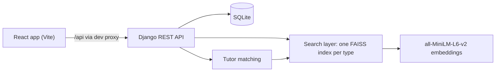

# Fisk Central Hub

An AI-powered platform connecting Fisk University students to campus organizations, a peer marketplace, and peer tutoring, all in one verified, Fisk-only space.

## The problem

Fisk students juggle disconnected tools for life outside class. Textbooks and dorm items change hands through GroupMe and word of mouth. Finding a tutor for a specific course depends on who you know. Keeping up with student organizations means checking flyers, Instagram pages, and email chains. This makes it harder, especially for first-years, to find support that already exists in the Fisk community.

## What it does

- **Fisk Organizations:** search and browse student organizations, see upcoming events, view members, and join with one click. Officers can post events.
- **Marketplace:** buy and sell textbooks, dorm items, and tickets with other verified Fisk students, then message the seller to arrange pickup.
- **Peer Tutoring:** describe what you need help with and get matched to peer tutors, ranked by how well their profile fits your request, whether they tutor your course, and whether your schedules overlap.
- **Verified trust layer:** only `@my.fisk.edu` addresses can register, and every account must confirm its email before logging in (relaxed in presentation mode, see below).
- **Intent-based search:** one search bar across tutors, listings, organizations, and events. It uses sentence embeddings, so "help with calc derivatives" finds the Calculus I tutor even if their profile never says "calc."

## Architecture



- **Frontend** (`client/`): React 19, TypeScript, Tailwind CSS 4, React Router. Pages are in `client/src/pages/`, and all API calls go through `client/src/api.ts`.
- **Backend** (`src/`): Django 5 and Django REST Framework, with session authentication and CSRF protection. Every endpoint lives under `/api/` (see `src/backend/urls.py`), and all of them except sign-up and login require a verified, logged-in user.
- **Search** (`src/backend/search.py`): listings, tutor profiles, organizations, and upcoming events are embedded with `sentence-transformers/all-MiniLM-L6-v2` and kept in in-memory FAISS indexes. Saving or deleting anything marks its index as stale (`signals.py`), and the index rebuilds on the next search, so new content is searchable without restarting.
- **Matching** (`src/backend/matching.py`): `score = 0.6 × semantic similarity + 0.25 × course match + 0.15 × availability overlap`. Students are never matched with themselves, and every match lists the reasons it was suggested.

### Data model

| Entity | Key fields |
| --- | --- |
| `Account` | Fisk email, `email_verified`, major, class year, bio, courses taken |
| `Listing` | title, description, price, condition, category, seller, sold flag |
| `TutorProfile` | user, courses, topics, weekly availability, active flag |
| `HelpRequest` / `TutorMatch` | request text, course, preferred times, status; ranked tutors with score and reasons |
| `Organization` / `Membership` / `Event` | org info and category; member roles (member, officer, admin); events with times and location |
| `Conversation` / `Message` | one conversation per pair of students |

## Getting started

### Prerequisites

- Python 3.11 or newer (developed on 3.12)
- Node.js 20 or newer and npm (developed on Node 22)
- An internet connection for the first setup. `pip install` downloads PyTorch as part of sentence-transformers (about 1 GB on some platforms), and the embedding model (about 90 MB) downloads the first time search or `seed_demo` runs. After that, everything works offline.

```bash
git clone https://github.com/Retro0106/Fisk-Central-Hub.git
cd Fisk-Central-Hub
```

### 1. Backend

```bash
python3 -m venv venv
source venv/bin/activate          # Windows: venv\Scripts\activate
pip install -r src/requirements.txt

cd src
python manage.py migrate
python manage.py seed_demo        # fictional demo students, tutors, listings, orgs, events
python manage.py runserver
```

### 2. Frontend (in a second terminal)

```bash
cd client
npm install
npm run dev
```

Open <http://localhost:5173>. Vite forwards `/api` requests to Django on port 8000.

### Demo accounts

`seed_demo` creates ten fictional students. They all use the password `FiskHub-demo-2026`. Good ones to try:

| Email | Role in the demo |
| --- | --- |
| `marcus.h@my.fisk.edu` | First-year with an accepted Calculus tutor match and an active chat |
| `amara.j@my.fisk.edu` | Calculus tutor, admin of the Mathematics & Physics Club |
| `simone.c@my.fisk.edu` | Has an open Data Structures help request with matches |
| `zoe.b@my.fisk.edu` | Officer in several organizations, so she can post events |

Run `python manage.py seed_demo --reset` to wipe and recreate only the demo data. All demo people, organizations, and events are made up.

### Presentation mode (on by default)

For demos, anyone can log in with **any `@my.fisk.edu` email and any password**, with no sign-up needed. A verified account is created the first time an email is used, and its name comes from the email (`jane.doe@my.fisk.edu` becomes "Jane Doe"). Any other email is rejected with "Email must be a @my.fisk.edu address."

Passwords aren't checked in this mode, so turn it off for any real deployment by setting `DEMO_LOGIN=false`. Login then requires a registered, email-verified account.

### Signing up for real

Registration only accepts `@my.fisk.edu` emails. In development, verification emails print in the terminal running Django, and the "Check your email" page also shows the link directly. To send real email, set the SMTP variables below.

## Configuration

Environment variables (all optional in development):

| Variable | Default | Purpose |
| --- | --- | --- |
| `DJANGO_DEBUG` | `true` | Turn off in production |
| `DJANGO_SECRET_KEY` | dev-only key | Required when debug is off |
| `DJANGO_ALLOWED_HOSTS` | `localhost,127.0.0.1` | Hostnames Django will serve |
| `ALLOWED_EMAIL_DOMAINS` | `my.fisk.edu` | Email domains allowed to register and log in |
| `DEMO_LOGIN` | `true` | Presentation mode: any allowed email logs in without signing up |
| `FRONTEND_URL` | `http://localhost:5173` | Base URL for verification links |
| `FRONTEND_ORIGINS` | Vite dev URLs | Origins trusted for CORS and CSRF |
| `EMAIL_HOST`, `EMAIL_PORT`, `EMAIL_HOST_USER`, `EMAIL_HOST_PASSWORD`, `EMAIL_USE_TLS` | unset | Send real email over SMTP instead of printing to the console |
| `SEARCH_MIN_SCORE` | `0.2` | Minimum cosine similarity for a search result |
| `VITE_API_URL` (frontend) | `/api` | Point the React app at a different API |

## Troubleshooting

- **`seed_demo` or the first search is slow:** it's downloading and loading the embedding model. This happens once. To seed without the model, run `python manage.py seed_demo --skip-search`. The demo help requests won't have tutor matches until you run `seed_demo` again without the flag (it's safe to rerun).
- **Login fails with a CSRF error:** open the app at `http://localhost:5173`. If you serve it from a different address, add that URL to `FRONTEND_ORIGINS`.
- **The frontend can't reach the API:** make sure Django is running on port 8000 in the other terminal.
- **Starting over:** delete `src/db.sqlite3`, then run `migrate` and `seed_demo` again.

## Useful commands

```bash
cd src
python manage.py test backend                                   # backend test suite (no model download needed)
python manage.py build_search_index --query "help with calc derivatives"   # try semantic search from the terminal
python manage.py createsuperuser                                # admin at http://127.0.0.1:8000/admin/

cd client
npm run lint
npm run build
```

## Repository structure

```text
Fisk-marketplace/
├── client/                    # React frontend
│   └── src/
│       ├── api.ts             # API client and shared types
│       ├── components/        # Layout (nav + global search) and UI building blocks
│       └── pages/             # One file per screen
├── src/                       # Django backend
│   ├── backend/
│   │   ├── models.py          # Data model
│   │   ├── views/             # API endpoints by feature
│   │   ├── search.py          # Semantic search indexes
│   │   ├── matching.py        # Tutor ranking
│   │   ├── management/commands/   # seed_demo, build_search_index
│   │   └── tests.py
│   └── server/settings.py
│   └── public/                # Demo listing and organization photos
├── docs/
│   ├── TECHNICAL_OVERVIEW.md  # Methods and technologies (also as Technical_Overview.docx)
│   └── wireframes/            # Low-fidelity wireframes of the core flows
└── SEMANTIC_SEARCH_WRITEUP.md # How and why semantic search works
```

## Roadmap

- **Research:** gather student feedback on pain points and feature priorities.
- **Test:** pilot with a small group of Fisk students, then tune `SEARCH_MIN_SCORE` and the matching weights based on what they find useful.
- **Later:** organization admin tools, notifications for new messages and matches, real-time chat instead of polling, and image uploads for listings.

## Contributors

- Daniel Chukwudera
- Jermaine Adesanya
